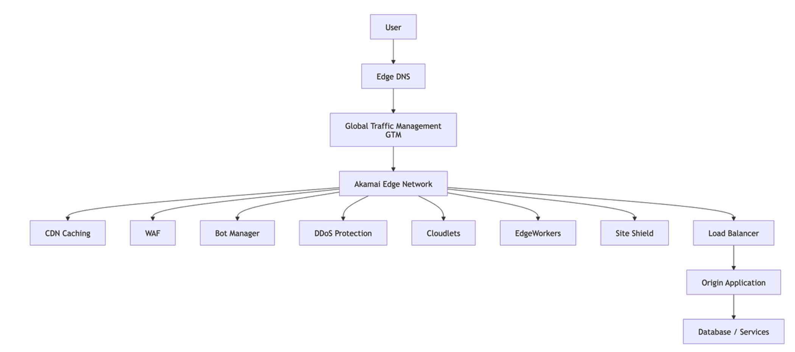
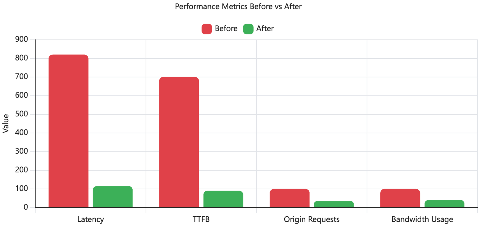

# Francisco Mondragon

## DevOps Engineer III

Specialized in Enterprise Web Delivery, Akamai CDN, Cloud Infrastructure, Performance Optimization, and DevOps Automation.

---

## Professional Summary

Experienced DevOps Engineer focused on large-scale web applications, CDN optimization, cloud platforms, traffic management, performance engineering, and infrastructure reliability.

### Core Skills

- Akamai CDN
- Edge DNS
- Traffic Routing
- Caching Strategies
- Azure
- Kubernetes (GKE)
- CI/CD
- GitHub Actions
- SSL/TLS
- DNS
- Performance Optimization
- Infrastructure as Code

---

# Capstone Project

## Enterprise Web Performance Optimization Using Akamai CDN

[Capstone Project]([resume.pdf](https://github.com/FranciscoMond/akamai-enterprise-web-delivery))

### Project Overview

This capstone project focuses on improving website performance through Akamai CDN optimization, edge caching, origin offloading, and intelligent traffic routing.

The goal was to reduce latency, improve Time To First Byte (TTFB), optimize bandwidth consumption, and reduce load on origin infrastructure.

---

## Business Problem

Users experienced slow response times due to excessive origin requests and insufficient cache utilization.

The project implemented Akamai caching policies and traffic optimization rules to improve performance while maintaining application reliability.

---

## Technologies Used

- Akamai CDN
- GKE
- DNS
- SSL/TLS
- Cache Key Optimization
- Traffic Management
- HTTP Headers
- Web Performance Monitoring

---

## Architecture

## Performance Results

## Results

| Metric | Before | After |
|----------|----------|----------|
| Latency | 820 ms | 115 ms |
| TTFB | 700 ms | 90 ms |
| Origin Requests | 100% | 35% |
| Bandwidth Usage | 100% | 40% |

---

## Key Deliverables

- Final Project Report
- Architecture Documentation
- Performance Analysis
- Routing Logic Design
- Testing Results
- Project Presentation

---

# Professional Experience

### DevOps Engineer III

Areas of expertise include:

- Enterprise CDN Delivery
- Web Performance Optimization
- Infrastructure Automation
- Cloud Architecture
- DNS Routing
- SSL Certificate Management
- Kubernetes Administration
- MarkMonitor
- Akamai
- Cloudflare

---

# Certifications

- Akamai Web Performance and Offload
- Akamai Web Application & API Protection
- Akamai Web Performance Foundations
- Akamai Automation and DevOps
- Verified International Academic Qualifications
- Guardicore Certified Segmentation Administrator (GCSA)
- Microsoft Certified: Azure Fundamentals
- ITIL Practitioner
- IT Information Library Foundations Certification (ITIL)

---

# GitHub Projects

## Akamai Enterprise Web Delivery

Repository:

https://github.com/FranciscoMond/akamai-enterprise-web-delivery

Project focused on:

- CDN Optimization
- Traffic Routing
- Edge Performance
- Cache Strategy Design

---

# Resume

[Download Resume](resume.pdf)

---

# Contact

### LinkedIn

www.linkedin.com/in/francisco-m-38b20711a

### GitHub

https://github.com/FranciscoMond

### Email

pancho.mondragon@icloud.com
